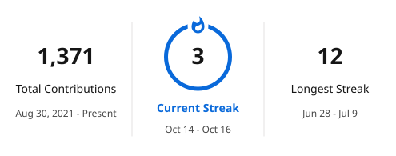

<h1 align="center">Hi, I'm Abdalrhman Balam</h1>

<strong>Full-Stack Developer | React &amp; Laravel | Flutter</strong>

I build web and mobile applications with clear interfaces, secure APIs and maintainable code.

  

  
  

### About me

I'm a software engineer based in Benghazi, Libya, with experience in full-stack web development and Flutter mobile apps. At **Wahda Bank**, I work on as DevOps. I also volunteer with **GDG** and contribute to software projects.

### Core skills

  <a href="https://github.com/tandpfun/skill-icons">
    <picture>
      <source media="(prefers-color-scheme: light)" srcset="https://skillicons.dev/icons?i=js%2Cts%2Cphp%2Cpython%2Cjava%2Cdart%2Chtml%2Ccss%2Creact%2Ctailwind%2Claravel%2Cnodejs%2Cexpress%2Cflutter%2Cmysql%2Cmongodb%2Cdocker%2Cgit%2Cgithub%2Cpostman&amp;perline=7&amp;theme=light" />
      
    </picture>
  </a>

 - **Frontend:** React, TypeScript and Tailwind CSS for responsive interfaces and admin dashboards.
 - **Backend:** Laravel, Node.js and Express for REST APIs, authentication and database-backed applications.
 - **Mobile:** Flutter and Dart for cross-platform apps connected to backend services.
 - **Development workflow:** Git, Docker and Postman for version control, containerized development and API testing.

### Projects

<table width="100%">
  <thead>
    <tr><th width="32%" align="left">Project</th><th width="68%" align="left">Overview &amp; technologies</th></tr>
  </thead>
  <tbody>
    <tr>
      <td valign="top"><strong>FoodScan / LibyaScan AI</strong> Private · In development</td>
      <td valign="top">Food-label scanning with Arabic and English nutrition OCR. Flutter · Laravel · FastAPI · PaddleOCR</td>
    </tr>
    <tr>
      <td valign="top"><strong>Wahda Bank</strong> Private · Professional work</td>
      <td valign="top">Trade-finance document reviews and approval workflows. Laravel · React · MySQL</td>
    </tr>
    <tr>
      <td valign="top"><strong>Sawti</strong> Private · GDG project</td>
      <td valign="top">A voice AI project developed through my GDG participation. Python · Voice AI</td>
    </tr>
    <tr>
      <td valign="top"><strong>Book Reader</strong> <a href="https://github.com/Abdooo2235/book-reader-flutter">Mobile app</a> · <a href="https://github.com/Abdooo2235/book-reader-store-backend">API</a> · <a href="https://github.com/Abdooo2235/book-reader-react-dashboard">Dashboard</a></td>
      <td valign="top">Digital reading, saved progress and personal libraries. Flutter · Laravel · React</td>
    </tr>
    <tr>
      <td valign="top"><strong>MERN Chat</strong> <a href="https://github.com/Abdooo2235/MERN-Chat-App">View repository</a></td>
      <td valign="top">Real-time messaging with chat history and online status. React · Node.js · MongoDB · Socket.io</td>
    </tr>
    <tr>
      <td valign="top"><strong>Inventory Management</strong> <a href="https://github.com/Abdooo2235/inventory-app-frontend">View repository</a></td>
      <td valign="top">A dashboard for products, suppliers and orders. React · TypeScript · shadcn/ui</td>
    </tr>
    <tr>
      <td valign="top"><strong>Pixify AI</strong> <a href="https://github.com/Abdooo2235/Pixify-AI">View repository</a></td>
      <td valign="top">Image enhancement with before-and-after comparisons. React · TypeScript · Express</td>
    </tr>
  </tbody>
</table>

More projects & repositories

[auth](https://github.com/Abdooo2235/auth) · [book-store](https://github.com/Abdooo2235/book-store) · [book_app_flutter](https://github.com/Abdooo2235/book_app_flutter) · [Data-Science-Project](https://github.com/Abdooo2235/Data-Science-Project) · [lati_game_app](https://github.com/Abdooo2235/lati_game_app) · [listy](https://github.com/Abdooo2235/listy) · [note_app](https://github.com/Abdooo2235/note_app) · [protfolio-website](https://github.com/Abdooo2235/protfolio-website) · [RedditVideoMakerBot](https://github.com/Abdooo2235/RedditVideoMakerBot) · [to_do](https://github.com/Abdooo2235/to_do)

**Forks of other developers' projects:**

[claw-code-parity](https://github.com/Abdooo2235/claw-code-parity) · [codex-plugin-cc](https://github.com/Abdooo2235/codex-plugin-cc) · [framework](https://github.com/Abdooo2235/framework) · [image](https://github.com/Abdooo2235/image) · [opendataloader-pdf](https://github.com/Abdooo2235/opendataloader-pdf) · [rea](https://github.com/Abdooo2235/rea) · [tiktok-lossless-upload](https://github.com/Abdooo2235/tiktok-lossless-upload)

### GitHub activity

  <a href="https://github.com/Abdooo2235?tab=overview">
    <picture>
      <source media="(prefers-color-scheme: dark)" srcset="assets/streak-dark.svg" />
      
    </picture>
  </a>

<picture>
  <source media="(prefers-color-scheme: dark)" srcset="assets/contributions-dark.svg" />
  
</picture>

<a href="https://github.com/Abdooo2235/Abdooo2235/actions/workflows/contributions.yml">Activity last refreshed</a> · Built with <a href="https://github.com/tandpfun/skill-icons">Skill Icons</a> · <a href="https://github.com/DenverCoder1/readme-typing-svg">Typing SVG</a> · <a href="https://github.com/DenverCoder1/github-readme-streak-stats">Streak Stats</a> · <a href="https://github.com/Platane/snk">snk</a>

