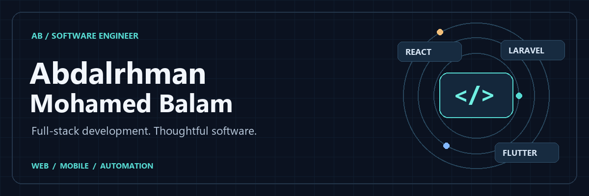
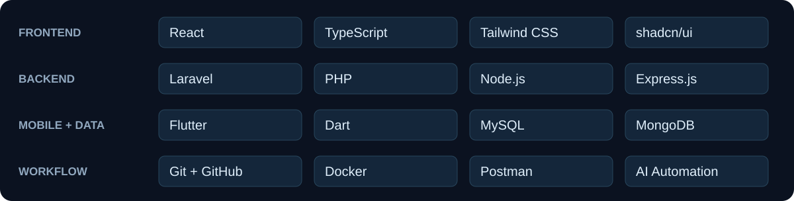

  

  <a href="#selected-work">Selected work</a> &nbsp;·&nbsp;
  <a href="#technical-toolkit">Technical toolkit</a> &nbsp;·&nbsp;
  <a href="#community">Community</a> &nbsp;·&nbsp;
  <a href="#project-directory">All public repositories</a> &nbsp;·&nbsp;
  <a href="mailto:abdalrhmantheiv18@gmail.com">Get in touch</a>

Benghazi, Libya &nbsp; / &nbsp; <a href="assets/hero.png">Static banner</a>

## About me

I'm **Abdalrhman Mohamed Balam**, a software engineer working across web applications, backend APIs and cross-platform mobile development. I build with **React, Laravel, Node.js and Flutter**, with an emphasis on clear interfaces, maintainable code and reliable workflows.

My experience includes trade-finance compliance software at **Wahda Bank**, full-stack training through **Future Company / Tatweer**, and mobile development through the **Libyan Academy for Telecom and Informatics**. I also volunteer with **Google Developer Groups (GDG)** and develop software projects such as **Sawti**.

**Education:** B.Sc. in Software Engineering, Libyan International University — graduated in 2026; official final certificate pending.

## Selected work

### Trade-Finance Compliance Dashboard · Wahda Bank

Document and compliance workflows covering **Letter of Credit → Goods Arrival → SWIFT Transfer**. My work includes sequential phase approvals, role-based access, audit trails and document handling, using Laravel, React, MySQL and Docker.

Professional work · Source code is private.

<table>
<tr>
<td width="50%" valign="top">

### 01 / Book Reader ecosystem

A digital reading experience with a Flutter app, Laravel API and React administration dashboard. Reading progress, library management and content administration across the stack.

**Flutter · Dart · Laravel · React · TypeScript**

[Mobile app](https://github.com/Abdooo2235/book-reader-flutter) · [API](https://github.com/Abdooo2235/book-reader-store-backend) · [Dashboard](https://github.com/Abdooo2235/book-reader-react-dashboard)

</td>
<td width="50%" valign="top">

### 02 / MERN Chat

Real-time messaging with authentication, message history, image sharing and online presence. A React interface connected to an Express API and Socket.io.

**MongoDB · Express · React · Node.js · Socket.io**

[Explore repository →](https://github.com/Abdooo2235/MERN-Chat-App)

</td>
</tr>
<tr>
<td width="50%" valign="top">

### 03 / Inventory Management

A responsive management interface for products, categories, suppliers, orders and users. Built with typed components, form validation and client/server state management.

**React · TypeScript · shadcn/ui · Zustand · SWR**

[Explore repository →](https://github.com/Abdooo2235/inventory-app-frontend)

</td>
<td width="50%" valign="top">

### 04 / Pixify AI

An image enhancement and upscaling project with a responsive interface and image comparison experience. Combines a React frontend with an Express backend.

**React · TypeScript · Tailwind CSS · Express**

[Explore repository →](https://github.com/Abdooo2235/Pixify-AI)

</td>
</tr>
</table>

**Also exploring data science:** [Stock Market Trend Analysis](https://github.com/Abdooo2235/Data-Science-Project) compares statistical, tree-based and deep learning models, with explicit out-of-sample evaluation and volatility analysis.

## Technical toolkit

| Area | Skills and tools |
| :--- | :--- |
| Languages | JavaScript, TypeScript, PHP, Java, Python, Dart, SQL |
| Frontend | React.js, HTML5, CSS3, Tailwind CSS, shadcn/ui, daisyUI, jQuery |
| Backend | Laravel, Node.js, Express.js, RESTful APIs, authentication, role-based access control |
| Mobile | Flutter, Dart, responsive interfaces, UI/UX design |
| Databases | MySQL, SQL, MongoDB |
| Tools & delivery | Git, GitHub, Docker, Postman, API testing, AI automation |
| Engineering | Clean code, debugging, troubleshooting, API integration, UI/UX best practices |
| Collaboration | Problem solving, communication, teamwork, adaptability, working under pressure |

## Community

**Google Developer Groups (GDG) · Volunteer & Software Project Developer**

I contribute as a volunteer and develop software projects, including **Sawti**. Community participation is part of how I keep learning, collaborate with other developers and put software ideas into practice.

## Project directory

Explore all my public repositories below. The directory includes learning projects and experiments alongside larger applications.

<strong>Public projects and experiments (16 repositories)</strong>

| Repository | Main language | Focus |
| :--- | :--- | :--- |
| [auth](https://github.com/Abdooo2235/auth) | PHP | Laravel authentication project |
| [book-reader-flutter](https://github.com/Abdooo2235/book-reader-flutter) | Dart | Cross-platform digital reading and library app |
| [book-reader-react-dashboard](https://github.com/Abdooo2235/book-reader-react-dashboard) | TypeScript | React administration dashboard for Book Reader |
| [book-reader-store-backend](https://github.com/Abdooo2235/book-reader-store-backend) | PHP | Laravel API for the Book Reader ecosystem |
| [book-store](https://github.com/Abdooo2235/book-store) | PHP | Laravel book-store project |
| [book_app_flutter](https://github.com/Abdooo2235/book_app_flutter) | Dart | Flutter book management application |
| [Data-Science-Project](https://github.com/Abdooo2235/Data-Science-Project) | HTML | Stock-market trend and volatility analysis |
| [inventory-app-frontend](https://github.com/Abdooo2235/inventory-app-frontend) | TypeScript | Inventory and order management interface |
| [lati_game_app](https://github.com/Abdooo2235/lati_game_app) | Dart | Flutter application project |
| [listy](https://github.com/Abdooo2235/listy) | PHP | Laravel application project |
| [MERN-Chat-App](https://github.com/Abdooo2235/MERN-Chat-App) | JavaScript | Real-time full-stack chat application |
| [note_app](https://github.com/Abdooo2235/note_app) | Blade | Laravel notes application project |
| [Pixify-AI](https://github.com/Abdooo2235/Pixify-AI) | TypeScript | Image enhancement and upscaling project |
| [protfolio-website](https://github.com/Abdooo2235/protfolio-website) | HTML | Personal portfolio website |
| [RedditVideoMakerBot](https://github.com/Abdooo2235/RedditVideoMakerBot) | Python | Python video automation repository |
| [to_do](https://github.com/Abdooo2235/to_do) | Dart | Flutter to-do application project |

<strong>Forked repositories (7 repositories)</strong>

These are forks of other developers' projects. Listing them here does not imply original authorship or an upstream contribution.

| Repository | Upstream project focus |
| :--- | :--- |
| [claw-code-parity](https://github.com/Abdooo2235/claw-code-parity) | claw-code Rust port parity work - it is temporary work while claw-code repo is doing migration |
| [codex-plugin-cc](https://github.com/Abdooo2235/codex-plugin-cc) | Use Codex from Claude Code to review code or delegate tasks. |
| [framework](https://github.com/Abdooo2235/framework) | Simple forum software for building great communities. |
| [image](https://github.com/Abdooo2235/image) | PHP Image Processing |
| [opendataloader-pdf](https://github.com/Abdooo2235/opendataloader-pdf) | PDF Parser for AI-ready data. Automate PDF accessibility. Open-source. |
| [rea](https://github.com/Abdooo2235/rea) | Reverse engineer anything with agents, from app behavior down to native binaries. |
| [tiktok-lossless-upload](https://github.com/Abdooo2235/tiktok-lossless-upload) | Patch your videos to upload them to TikTok losslessly, but now fully open source. |

Directory snapshot: October 2026. Professional and community projects with private source are described above where appropriate.

## Let's connect

For software development opportunities, collaboration or a conversation about a project:

**[abdalrhmantheiv18@gmail.com](mailto:abdalrhmantheiv18@gmail.com)** · **[GitHub](https://github.com/Abdooo2235)**

Arabic — Native · English — Intermediate · Turkish — Beginner

---

Thoughtful interfaces. Reliable systems. Always learning.

